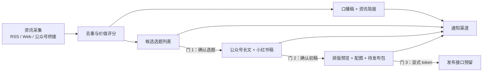

# SelfMedia Agent

一个可本地运行、人工可控的个人自媒体内容流水线。它把每日资讯采集、通勤口播稿、选题生成、公众号长文、小红书改写、配图生成、通知提醒和公众号草稿箱写入串成一条半自动链路。

核心设计原则不是「一键无人值守发布」，而是 **机器做重活，人做判断**：

- 采集、去重、评分、起草、排版、画图由脚本完成；
- 选题、定稿、发布三个环节保留人工确认门；
- 线上发布默认关闭，仓库内不内置任何账号密钥或平台凭据。

---

## 它能做什么

| 阶段 | 产出 | 说明 |
| --- | --- | --- |
| 资讯采集 | `news.json` / `digest.md` | RSS、Web 搜索预留、公众号桥接 RSS 或人工素材清单；按来源、标题、链接、时间、摘要整理 |
| 去重评分 | 去重后候选池 | URL 归一化 + 标题相似度去重；来源权重、关键词、时效半衰期、摘要完整度综合打分 |
| 通勤口播 | `audio_script.md` / `audio_meta.json` | 中文短句口播稿，音频合成接口预留 |
| 选题生成 | `topics.json` | 标题、角度、核心论点、素材来源、推荐优先级，等待人工确认 |
| 文章生成 | `*_wechat.md` / `*_xhs.md` | 公众号长文与小红书版本；写作风格由 `prompts/` 注入 |
| 配图生成 | `*.svg` / `*.png` | 纯代码 SVG，可转 PNG 并内联为 data URI，也可上传后替换为公网 URL |
| 排版预览 | `*_paste.html` / `preview.html` | 公众号可粘贴富文本 + 本地手机预览页，一键复制渲染后内容而非 HTML 源码 |
| 通知提醒 | `data/inbox/` / 桌面 / 企业微信 | 产物就绪后主动提醒；默认使用零依赖文件收件箱 |
| 发布准备 | `publish/*.json` | 只生成待发布包；线上发布需显式确认 token，仓库本身不实现无人值守群发 |

---

## 流程总览



三道人工门由 `src/gates.py` 强制检查，未确认直接抛 `GateError`，不会静默跳过。

---

## 目录结构

```text
selfmedia-agent/
├── config/
│   ├── config.json              # 全局配置：定时、LLM、通知、门控、评分、去重
│   └── sources.json             # 采集源：RSS、Web 搜索、公众号桥接、fixture 路径
├── fixtures/                    # 离线样例，保证无网络也能跑通
│   ├── news_sample.json
│   ├── hot_questions_sample.json
│   ├── topics_sample.json
│   └── wechat_manual.json
├── prompts/                     # 注入给 LLM 的提示词
│   ├── 00_system.md             # 总 system prompt
│   ├── 01_audio_script.md       # 通勤口播稿
│   ├── 02_topics.md             # 选题生成
│   ├── 03_kazix_style.md        # 口语化写作风格与硬核落地五段式
│   ├── 04_wechat_format.md      # 公众号排版红线
│   ├── 05_wechat_draft.md       # 公众号长文
│   └── 06_xiaohongshu.md        # 小红书改写
├── scripts/
│   ├── illustrations.py         # 通用 SVG 配图生成
│   ├── build_wechat_preview.py  # Markdown → 公众号内联样式 HTML + 预览页
│   └── prepare_publish.py       # SVG → PNG → payload 准备
├── run/
│   ├── run_daily.bat            # Windows 定时启动示例
│   └── install_task.ps1         # Windows 计划任务注册示例
├── src/
│   ├── cli.py                   # 命令行入口
│   ├── workflow.py              # 流程编排
│   ├── config.py                # 配置加载
│   ├── models.py                # 数据结构、URL 归一化、去重
│   ├── utils.py                 # 时间、文本、JSON、Prompt 工具
│   ├── gates.py                 # 三道人工确认门
│   ├── notifier.py              # 多渠道通知
│   ├── scheduler.py             # 每日定时封装
│   ├── verify.py                # 自检脚本
│   ├── collectors/              # RSS / Web / 公众号采集器
│   ├── llm/                     # mock 与 OpenAI 兼容 Live 双模式
│   ├── pipeline/                # 口播、选题、写作、评分
│   └── publisher/               # 发布接口预留
├── data/                        # 运行产物（已被 .gitignore 忽略）
├── output/                      # 文章与配图产物（已被 .gitignore 忽略）
├── requirements.txt
└── README.md
```

---

## 快速开始

### 1. 环境要求

- Python 3.10+
- 仅使用标准库即可跑通 `mock` 流程
- `live` 模式需要可访问 OpenAI 兼容 Chat Completions 接口
- 可选依赖见 `requirements.txt`，用于 SVG→PNG 等增强能力

### 2. 安装

```bash
git clone <你的仓库地址>.git
cd selfmedia-agent
python -m pip install -r requirements.txt   # 可选，mock 流程不需要
```

### 3. 先跑一次离线自检

```bash
python -m src.cli verify
```

自检覆盖去重、评分、排版红线、span 包裹、人工门控和端到端 `run-all`。

### 4. 用内置样例跑通完整流程

```bash
python -m src.cli run-all --date 2026-01-01
```

产物默认写入 `data/2026-01-01/`，包括简报、口播稿、选题、文章、小红书稿和待发布包。

### 5. 切到真实 LLM

编辑 `config/config.json`：

```json
{
  "llm": {
    "mode": "live",
    "provider": "openai_compat",
    "base_url": "https://api.openai.com/v1",
    "api_key_env": "OPENAI_API_KEY",
    "model": "gpt-4o-mini"
  }
}
```

然后设置环境变量（不要把密钥写进仓库）：

```bash
# macOS / Linux
export OPENAI_API_KEY=你的密钥

# Windows PowerShell
$env:OPENAI_API_KEY = "你的密钥"
```

再运行需要的阶段即可。

---

## 命令速查

```bash
python -m src.cli collect              # 采集资讯
python -m src.cli script               # 生成口播稿
python -m src.cli topics               # 生成选题候选
python -m src.cli approve topics --id <topic_id>
python -m src.cli drafts               # 生成公众号 / 小红书初稿
python -m src.cli approve drafts --id <draft_id>
python -m src.cli publish              # 生成待发布包
python -m src.cli status               # 查看流程状态
python -m src.cli verify               # 自检
python -m src.cli inbox                # 查看通知收件箱
python -m src.cli notify               # 手动触发一次通知
python -m src.cli run-all --date YYYY-MM-DD
```

`--date` 可以放在子命令前后，CLI 两处都做了兼容。

---

## 配置说明

### `config/config.json`

| 字段 | 作用 |
| --- | --- |
| `timezone` / `daily_time` | 定时任务默认时区与时间点 |
| `lookback_hours` | 每次采集回溯窗口，默认 24 小时 |
| `llm.mode` | `mock` 离线样例，`live` 调真实接口 |
| `notify.channels` | 通知渠道，默认 `inbox`，可加 `desktop` / `wecom` / `mail` |
| `publish.enabled` | 线上发布总开关，默认 `false` |
| `gates.*` | 三道人工确认门开关，默认全部开启 |
| `ranking` | 来源权重、关键词加权、时效半衰期 |
| `dedup` | 标题相似度阈值与需剥离的追踪参数 |

### `config/sources.json`

- `rss`：RSS/Atom 源，可按需启停；
- `web_search`：预留接口，未配置时跳过并记 warning；
- `wechat`：公众号无公开聚合 API，支持配置桥接 RSS 或人工素材清单；
- `hot_questions`：热点问题来源与 fixture 兜底；
- `fixtures`：离线样例路径。

### `prompts/`

`03_kazix_style.md` 定义了口语化、硬核落地五段式、产品对照落地、重点分层着色等写作规则。其中开场白是**可配置项**，请按你自己的账号替换，不同账号之间不要混用。

`04_wechat_format.md` 定义了公众号排版红线：全内联样式、文字节点用 `span` 包裹、禁止 `class` / `id` / `position` / `grid` / CSS 变量 / 外链脚本，三连顺序固定为点赞、转发、推荐。

---

## 通知机制

默认 `inbox` 渠道零依赖，写入 `data/inbox/YYYY-MM-DD.md` 与 `notifications.jsonl`。可选渠道：

- `desktop`：Windows 桌面 Toast，best-effort；
- `wecom`：需本机已连接并可用 `wecom-cli`。若 Python 直接调用 sh 包装脚本失败，可设置：
  - `WECOM_CLI_JS`：底层 `wecom.js` 路径；
  - `WECOM_NODE_EXE`：`node.exe` 路径。
- `mail`：只生成待发送草稿，需人工确认后发送。

任一渠道失败只记 warning，不阻断主流程。

---

## 配图方案

`scripts/illustrations.py` 用纯代码生成 SVG，好处是可版本控制、可复制、无需设计工具。`scripts/prepare_publish.py` 负责：

1. SVG → PNG（推荐 `resvg-py`，自带二进制，无系统 libcairo 依赖）；
2. PNG → data URI 内联进本地预览页，保证复制富文本时图片能带走；
3. 生成发布用 payload。

如需写入公众号草稿箱，图片必须是**公网可访问的 http/https 地址**，且格式为 `jpg/png/gif/webp`。本地 data URI 只用于预览，正式发布前要把图片上传到图床或对象存储并替换 payload 中的 URL。

---

## 公众号草稿箱发布边界

这个仓库刻意不实现无人值守发布：

- 核心 `publisher` 只有 `prepare()` 与受控 `publish()` 接口；
- `publish()` 要求显式 `CONFIRM-<id>` token；
- 默认 `publish.enabled = false`；
- 不存储 AppID、AppSecret、API Key、公众号 ID、草稿 ID、media_id 等凭据。

如果你在支持公众号连接器的工作台里使用，可以在人工确认后，把本仓库生成的细粒度 blocks payload 交给连接器写入**草稿箱**。连接器只写草稿，不群发；这一步在工作台侧完成，凭据由工作台管理，不进入本仓库。

> 排版 payload 建议保持细粒度：一个短句或一个段落对应一个 block。若把多句用换行塞进同一个 paragraph，公众号后台会把它们挤成一团，视觉上看起来像「没有分段」。

---

## 隐私与安全

发布前已做以下处理：

- 删除全部 `data/`、`output/`、`.workbuddy/` 运行产物；
- 删除真实文章正文、真实稿号、media_id、公众号名和私有图床 URL；
- 将本机 Python / Node 路径改为通用命令或环境变量；
- 将账号专属开场白改为可配置项；
- 通知渠道默认改为零依赖 `inbox`；
- 保留的 `fixtures/` 全部是离线样例，不含真实用户数据。

建议你自己使用时也遵循同样边界：密钥放环境变量，运行产物加入 `.gitignore`，不要把真实文章成品和平台 ID 提交进公开仓库。

---

## Roadmap

- [ ] Web 搜索采集器接入真实搜索 API
- [ ] 音频合成接口落地
- [ ] 更多排版主题与配图风格
- [ ] 小红书图文自动排版
- [ ] 选题效果回收与评分模型迭代
- [ ] 多账号配置隔离

---

## 许可与致谢

本项目代码使用 MIT License，见 [LICENSE](LICENSE)。

写作风格规则参考了公开 khazix-writer skill 的思路，排版规则参考了公开的花叔排版 skill。两者仅作为方法论参考，具体规则已按本项目需要重写；商业使用请自行核对原始仓库与许可。

---

**一句话总结**：这是一个把自媒体重复劳动自动化、把判断权留给人的本地工作流骨架。
