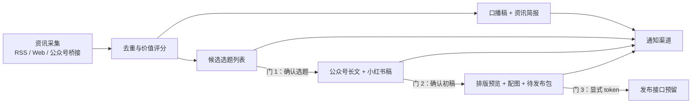
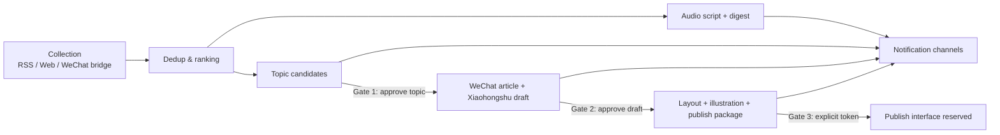

# SelfMedia Agent

A local, human-in-the-loop pipeline for personal content creation / 可本地运行、人工可控的个人自媒体内容流水线

| 中文 | English |
| :---: | :---: |
| [**阅读中文文档 ↓**](#chinese-document) | [**Read English Doc ↓**](#english-document) |

---

<a id="chinese-document"></a>

# 中文文档

一个可本地运行、人工可控的个人自媒体内容流水线。它把每日资讯采集、通勤口播稿、选题生成、公众号长文、小红书改写、配图生成、通知提醒和公众号草稿箱写入串成一条半自动链路。

核心设计原则不是「一键无人值守发布」，而是 **机器做重活，人做判断**：

- 采集、去重、评分、起草、排版、画图由脚本完成；
- 选题、定稿、发布三个环节保留人工确认门；
- 线上发布默认关闭，仓库内不内置任何账号密钥或平台凭据。

[↑ 切换语言 / Switch language](#selfmedia-agent)

---

## 它能做什么

| 阶段 | 产出 | 说明 |
| --- | --- | --- |
| 资讯采集 | `news.json` / `digest.md` | RSS、Web 搜索预留、公众号桥接 RSS 或人工素材清单；按来源、标题、链接、时间、摘要整理 |
| 去重评分 | 去重后候选池 | URL 归一化 + 标题相似度去重；来源权重、关键词、时效半衰期、摘要完整度综合打分 |
| 通勤口播 | `audio_script.md` / `audio_meta.json` | 中文短句口播稿，音频合成接口预留 |
| 选题生成 | `topics.json` | 标题、角度、核心论点、素材来源、推荐优先级，等待人工确认 |
| 文章生成 | `*_wechat.md` / `*_xhs.md` | 公众号长文与小红书版本；写作风格由 `prompts/` 注入 |
| 配图生成 | `*.svg` / `*.png` | 纯代码 SVG，可转 PNG 并内联为 data URI，也可上传后替换为公网 URL |
| 教程截图 | `shot_*.png` + 图注 | 截桌面/窗口/区域，脱敏，上传图床后插入文章，详见 [教程截图流程](docs/tutorial-screenshots.md) |
| 排版预览 | `*_paste.html` / `preview.html` | 公众号可粘贴富文本 + 本地手机预览页，一键复制渲染后内容而非 HTML 源码 |
| 通知提醒 | `data/inbox/` / 桌面 / 企业微信 | 产物就绪后主动提醒；默认使用零依赖文件收件箱 |
| 发布准备 | `publish/*.json` | 只生成待发布包；线上发布需显式确认 token，仓库本身不实现无人值守群发 |

---

## 流程总览



三道人工门由 `src/gates.py` 强制检查，未确认直接抛 `GateError`，不会静默跳过。

---

## 目录结构

```text
selfmedia-agent/
├── config/
│   ├── config.json              # 全局配置：定时、LLM、通知、门控、评分、去重
│   └── sources.json             # 采集源：RSS、Web 搜索、公众号桥接、fixture 路径
├── fixtures/                    # 离线样例，保证无网络也能跑通
│   ├── news_sample.json
│   ├── hot_questions_sample.json
│   ├── topics_sample.json
│   └── wechat_manual.json
├── prompts/                     # 注入给 LLM 的提示词
│   ├── 00_system.md             # 总 system prompt
│   ├── 01_audio_script.md       # 通勤口播稿
│   ├── 02_topics.md             # 选题生成
│   ├── 03_kazix_style.md        # 口语化写作风格与硬核落地五段式
│   ├── 04_wechat_format.md      # 公众号排版红线
│   ├── 05_wechat_draft.md       # 公众号长文
│   └── 06_xiaohongshu.md        # 小红书改写
├── scripts/
│   ├── illustrations.py         # 通用 SVG 配图生成
│   ├── build_wechat_preview.py  # Markdown → 公众号内联样式 HTML + 预览页
│   ├── prepare_publish.py       # SVG → PNG → payload 准备
│   ├── tutorial_capture.py      # 教程截屏 + 脱敏 + 图注（见 docs/）
│   └── tutorial_publish.py      # 截图上传清单 + 文章图位 payload（见 docs/）
├── docs/
│   └── tutorial-screenshots.md  # 教程截图 → 公众号配图完整流程
├── run/
│   ├── run_daily.bat            # Windows 定时启动示例
│   └── install_task.ps1         # Windows 计划任务注册示例
├── src/
│   ├── cli.py                   # 命令行入口
│   ├── workflow.py              # 流程编排
│   ├── config.py                # 配置加载
│   ├── models.py                # 数据结构、URL 归一化、去重
│   ├── utils.py                 # 时间、文本、JSON、Prompt 工具
│   ├── gates.py                 # 三道人工确认门
│   ├── notifier.py              # 多渠道通知
│   ├── scheduler.py             # 每日定时封装
│   ├── verify.py                # 自检脚本
│   ├── collectors/              # RSS / Web / 公众号采集器
│   ├── llm/                     # mock 与 OpenAI 兼容 Live 双模式
│   ├── pipeline/                # 口播、选题、写作、评分
│   └── publisher/               # 发布接口预留
├── data/                        # 运行产物（已被 .gitignore 忽略）
├── output/                      # 文章与配图产物（已被 .gitignore 忽略）
├── requirements.txt
└── README.md
```

---

## 快速开始

### 1. 环境要求

- Python 3.10+
- 仅使用标准库即可跑通 `mock` 流程
- `live` 模式需要可访问 OpenAI 兼容 Chat Completions 接口
- 可选依赖见 `requirements.txt`，用于 SVG→PNG 等增强能力

### 2. 安装

```bash
git clone <你的仓库地址>.git
cd selfmedia-agent
python -m pip install -r requirements.txt   # 可选，mock 流程不需要
```

### 3. 先跑一次离线自检

```bash
python -m src.cli verify
```

自检覆盖去重、评分、排版红线、span 包裹、人工门控和端到端 `run-all`。

### 4. 用内置样例跑通完整流程

```bash
python -m src.cli run-all --date 2026-01-01
```

产物默认写入 `data/2026-01-01/`，包括简报、口播稿、选题、文章、小红书稿和待发布包。

### 5. 切到真实 LLM

编辑 `config/config.json`：

```json
{
  "llm": {
    "mode": "live",
    "provider": "openai_compat",
    "base_url": "https://api.openai.com/v1",
    "api_key_env": "OPENAI_API_KEY",
    "model": "gpt-4o-mini"
  }
}
```

然后设置环境变量（不要把密钥写进仓库）：

```bash
# macOS / Linux
export OPENAI_API_KEY=你的密钥

# Windows PowerShell
$env:OPENAI_API_KEY = "你的密钥"
```

再运行需要的阶段即可。

---

## 命令速查

```bash
python -m src.cli collect              # 采集资讯
python -m src.cli script               # 生成口播稿
python -m src.cli topics               # 生成选题候选
python -m src.cli approve topics --id <topic_id>
python -m src.cli drafts               # 生成公众号 / 小红书初稿
python -m src.cli approve drafts --id <draft_id>
python -m src.cli publish              # 生成待发布包
python -m src.cli status               # 查看流程状态
python -m src.cli verify               # 自检
python -m src.cli inbox                # 查看通知收件箱
python -m src.cli notify               # 手动触发一次通知
python -m src.cli run-all --date YYYY-MM-DD
```

`--date` 可以放在子命令前后，CLI 两处都做了兼容。

---

## 配置说明

### `config/config.json`

| 字段 | 作用 |
| --- | --- |
| `timezone` / `daily_time` | 定时任务默认时区与时间点 |
| `lookback_hours` | 每次采集回溯窗口，默认 24 小时 |
| `llm.mode` | `mock` 离线样例，`live` 调真实接口 |
| `notify.channels` | 通知渠道，默认 `inbox`，可加 `desktop` / `wecom` / `mail` |
| `publish.enabled` | 线上发布总开关，默认 `false` |
| `gates.*` | 三道人工确认门开关，默认全部开启 |
| `ranking` | 来源权重、关键词加权、时效半衰期 |
| `dedup` | 标题相似度阈值与需剥离的追踪参数 |

### `config/sources.json`

- `rss`：RSS/Atom 源，可按需启停；
- `web_search`：预留接口，未配置时跳过并记 warning；
- `wechat`：公众号无公开聚合 API，支持配置桥接 RSS 或人工素材清单；
- `hot_questions`：热点问题来源与 fixture 兜底；
- `fixtures`：离线样例路径。

### `prompts/`

`03_kazix_style.md` 定义了口语化、硬核落地五段式、产品对照落地、重点分层着色等写作规则。其中开场白是**可配置项**，请按你自己的账号替换，不同账号之间不要混用。

`04_wechat_format.md` 定义了公众号排版红线：全内联样式、文字节点用 `span` 包裹、禁止 `class` / `id` / `position` / `grid` / CSS 变量 / 外链脚本，三连顺序固定为点赞、转发、推荐。

---

## 通知机制

默认 `inbox` 渠道零依赖，写入 `data/inbox/YYYY-MM-DD.md` 与 `notifications.jsonl`。可选渠道：

- `desktop`：Windows 桌面 Toast，best-effort；
- `wecom`：需本机已连接并可用 `wecom-cli`。若 Python 直接调用 sh 包装脚本失败，可设置：
  - `WECOM_CLI_JS`：底层 `wecom.js` 路径；
  - `WECOM_NODE_EXE`：`node.exe` 路径。
- `mail`：只生成待发送草稿，需人工确认后发送。

任一渠道失败只记 warning，不阻断主流程。

---

## 配图方案

`scripts/illustrations.py` 用纯代码生成 SVG，好处是可版本控制、可复制、无需设计工具。`scripts/prepare_publish.py` 负责：

1. SVG → PNG（推荐 `resvg-py`，自带二进制，无系统 libcairo 依赖）；
2. PNG → data URI 内联进本地预览页，保证复制富文本时图片能带走；
3. 生成发布用 payload。

如需写入公众号草稿箱，图片必须是**公网可访问的 http/https 地址**，且格式为 `jpg/png/gif/webp`。本地 data URI 只用于预览，正式发布前要把图片上传到图床或对象存储并替换 payload 中的 URL。

---

## 公众号草稿箱发布边界

这个仓库刻意不实现无人值守发布：

- 核心 `publisher` 只有 `prepare()` 与受控 `publish()` 接口；
- `publish()` 要求显式 `CONFIRM-<id>` token；
- 默认 `publish.enabled = false`；
- 不存储 AppID、AppSecret、API Key、公众号 ID、草稿 ID、media_id 等凭据。

如果你在支持公众号连接器的工作台里使用，可以在人工确认后，把本仓库生成的细粒度 blocks payload 交给连接器写入**草稿箱**。连接器只写草稿，不群发；这一步在工作台侧完成，凭据由工作台管理，不进入本仓库。

> 排版 payload 建议保持细粒度：一个短句或一个段落对应一个 block。若把多句用换行塞进同一个 paragraph，公众号后台会把它们挤成一团，视觉上看起来像「没有分段」。

---

## 隐私与安全

发布前已做以下处理：

- 删除全部 `data/`、`output/`、`.workbuddy/` 运行产物；
- 删除真实文章正文、真实稿号、media_id、公众号名和私有图床 URL；
- 将本机 Python / Node 路径改为通用命令或环境变量；
- 将账号专属开场白改为可配置项；
- 通知渠道默认改为零依赖 `inbox`；
- 保留的 `fixtures/` 全部是离线样例，不含真实用户数据。

建议你自己使用时也遵循同样边界：密钥放环境变量，运行产物加入 `.gitignore`，不要把真实文章成品和平台 ID 提交进公开仓库。

---

## Roadmap

- [ ] Web 搜索采集器接入真实搜索 API
- [ ] 音频合成接口落地
- [ ] 更多排版主题与配图风格
- [ ] 小红书图文自动排版
- [ ] 选题效果回收与评分模型迭代
- [ ] 多账号配置隔离
- [ ] 智能截图脱敏与箭头步骤标注

---

## 许可与致谢

本项目代码使用 MIT License，见 [LICENSE](LICENSE)。

写作风格规则参考了公开 khazix-writer skill 的思路，排版规则参考了公开的花叔排版 skill。两者仅作为方法论参考，具体规则已按本项目需要重写；商业使用请自行核对原始仓库与许可。

---

**一句话总结**：这是一个把自媒体重复劳动自动化、把判断权留给人的本地工作流骨架。

[↑ 回到顶部 / Back to top](#selfmedia-agent)

---

<a id="english-document"></a>

# English Document

A locally runnable, human-in-the-loop pipeline for personal content creation. It chains daily news collection, commute audio scripts, topic generation, long-form WeChat articles, Xiaohongshu rewrites, illustration generation, notifications and WeChat draft-box writing into a semi-automated flow.

The core principle is not "one-click unattended publishing" but **machines do the heavy lifting, humans make the decisions**:

- Collection, dedup, ranking, drafting, layout and illustration are handled by scripts;
- Topic selection, finalization and publishing keep human approval gates;
- Online publishing is off by default and no account secrets or platform credentials are bundled.

[↑ Switch language / 切换语言](#selfmedia-agent)

---

## What it does

| Stage | Output | Description |
| --- | --- | --- |
| Collection | `news.json` / `digest.md` | RSS, reserved web search, WeChat bridge RSS or manual material lists; organized by source, title, link, time and summary |
| Dedup & ranking | Deduped candidate pool | URL normalization + title-similarity dedup; scored by source weight, keywords, recency half-life and summary completeness |
| Audio script | `audio_script.md` / `audio_meta.json` | Short-sentence Chinese commute script, with audio synthesis interface reserved |
| Topic generation | `topics.json` | Title, angle, core thesis, sources and priority, awaiting human approval |
| Article drafting | `*_wechat.md` / `*_xhs.md` | WeChat long-form and Xiaohongshu versions; writing style injected via `prompts/` |
| Illustration | `*.svg` / `*.png` | Pure-code SVG, convertible to PNG and inline data URI, or uploadable to a public URL |
| Screenshot | `shot_*.png` + captions | Capture screen/window/region, redact, upload and insert into articles; see [screenshot guide](docs/tutorial-screenshots.md) |
| Layout preview | `*_paste.html` / `preview.html` | Paste-ready rich text + local mobile preview; one-click copy of rendered content, not HTML source |
| Notification | `data/inbox/` / desktop / WeCom | Proactive alerts when outputs are ready; zero-dependency file inbox by default |
| Publish prep | `publish/*.json` | Only generates publish packages; online publishing requires an explicit token, no unattended mass sending |

---

## Pipeline overview



Three human gates are enforced by `src/gates.py`; unconfirmed stages raise `GateError` instead of silently passing.

---

## Project structure

```text
selfmedia-agent/
├── config/
│   ├── config.json              # Global config: schedule, LLM, notify, gates, ranking, dedup
│   └── sources.json             # Sources: RSS, web search, WeChat bridge, fixture paths
├── fixtures/                    # Offline samples so it runs without network
│   ├── news_sample.json
│   ├── hot_questions_sample.json
│   ├── topics_sample.json
│   └── wechat_manual.json
├── prompts/                     # Prompts injected into the LLM
│   ├── 00_system.md             # Global system prompt
│   ├── 01_audio_script.md       # Commute audio script
│   ├── 02_topics.md             # Topic generation
│   ├── 03_kazix_style.md        # Conversational style & five-part deep-dive structure
│   ├── 04_wechat_format.md      # WeChat formatting rules
│   ├── 05_wechat_draft.md       # WeChat long-form article
│   └── 06_xiaohongshu.md        # Xiaohongshu rewrite
├── scripts/
│   ├── illustrations.py         # Generic SVG illustration generator
│   ├── build_wechat_preview.py  # Markdown → inline-styled WeChat HTML + preview
│   ├── prepare_publish.py       # SVG → PNG → payload preparation
│   ├── tutorial_capture.py      # Tutorial capture + redaction + captions (see docs/)
│   └── tutorial_publish.py      # Upload list + article image payload (see docs/)
├── docs/
│   └── tutorial-screenshots.md  # Screenshot-to-article image workflow
├── run/
│   ├── run_daily.bat            # Windows scheduled start example
│   └── install_task.ps1         # Windows task registration example
├── src/
│   ├── cli.py                   # CLI entry point
│   ├── workflow.py              # Workflow orchestration
│   ├── config.py                # Config loading
│   ├── models.py                # Data models, URL normalization, dedup
│   ├── utils.py                 # Time, text, JSON and prompt utilities
│   ├── gates.py                 # Three human approval gates
│   ├── notifier.py              # Multi-channel notification
│   ├── scheduler.py             # Daily scheduling wrapper
│   ├── verify.py                # Self-check script
│   ├── collectors/              # RSS, web and WeChat collectors
│   ├── llm/                     # Mock and OpenAI-compatible live modes
│   ├── pipeline/                # Audio, topics, writing, ranking
│   └── publisher/               # Publishing interface reserved
├── data/                        # Runtime outputs (gitignored)
├── output/                      # Article and image outputs (gitignored)
├── requirements.txt
└── README.md
```

---

## Quick start

### 1. Requirements

- Python 3.10+
- Standard library alone is enough for `mock` mode
- `live` mode needs an OpenAI-compatible Chat Completions endpoint
- Optional dependencies in `requirements.txt` for SVG→PNG and other enhancements

### 2. Install

```bash
git clone <your-repo-url>.git
cd selfmedia-agent
python -m pip install -r requirements.txt   # optional, not needed for mock
```

### 3. Run the offline self-check

```bash
python -m src.cli verify
```

The self-check covers dedup, ranking, formatting red lines, span wrapping, approval gates and end-to-end `run-all`.

### 4. Run the full flow with built-in samples

```bash
python -m src.cli run-all --date 2026-01-01
```

Outputs go to `data/2026-01-01/` by default: digest, audio script, topics, articles, Xiaohongshu drafts and publish packages.

### 5. Switch to a real LLM

Edit `config/config.json`:

```json
{
  "llm": {
    "mode": "live",
    "provider": "openai_compat",
    "base_url": "https://api.openai.com/v1",
    "api_key_env": "OPENAI_API_KEY",
    "model": "gpt-4o-mini"
  }
}
```

Then set the environment variable (never commit the key):

```bash
# macOS / Linux
export OPENAI_API_KEY=your-key

# Windows PowerShell
$env:OPENAI_API_KEY = "your-key"
```

Then run whichever stage you need.

---

## Command reference

```bash
python -m src.cli collect              # collect news
python -m src.cli script               # generate audio script
python -m src.cli topics               # generate topic candidates
python -m src.cli approve topics --id <topic_id>
python -m src.cli drafts               # generate WeChat / Xiaohongshu drafts
python -m src.cli approve drafts --id <draft_id>
python -m src.cli publish              # generate publish package
python -m src.cli status               # show pipeline status
python -m src.cli verify               # self-check
python -m src.cli inbox                # show notification inbox
python -m src.cli notify               # trigger a notification
python -m src.cli run-all --date YYYY-MM-DD
```

`--date` works both before and after the subcommand; the CLI supports both positions.

---

## Configuration

### `config/config.json`

| Field | Purpose |
| --- | --- |
| `timezone` / `daily_time` | Default timezone and time for scheduling |
| `lookback_hours` | Collection lookback window, 24 hours by default |
| `llm.mode` | `mock` for offline samples, `live` for real API |
| `notify.channels` | Notification channels; `inbox` by default, optionally `desktop` / `wecom` / `mail` |
| `publish.enabled` | Global publish switch, `false` by default |
| `gates.*` | Switches for the three approval gates, all on by default |
| `ranking` | Source weights, keyword boosts, recency half-life |
| `dedup` | Title similarity threshold and tracking params to strip |

### `config/sources.json`

- `rss`: RSS/Atom feeds, enabled as needed;
- `web_search`: reserved interface; skipped with a warning when unconfigured;
- `wechat`: no public WeChat aggregation API; supports bridge RSS or manual material lists;
- `hot_questions`: hot-question sources with fixture fallback;
- `fixtures`: paths to offline samples.

### `prompts/`

`03_kazix_style.md` defines the conversational style, five-part deep-dive structure, product-comparison grounding and layered highlighting. The opening line is **configurable** — replace it with your own and do not mix accounts.

`04_wechat_format.md` defines WeChat formatting red lines: all styles inline, text nodes wrapped in `span`, no `class` / `id` / `position` / `grid` / CSS variables / external scripts, and a fixed call-to-action order of like, share, recommend.

---

## Notification

The `inbox` channel is dependency-free by default, writing to `data/inbox/YYYY-MM-DD.md` and `notifications.jsonl`. Optional channels:

- `desktop`: Windows desktop Toast, best-effort;
- `wecom`: requires a connected `wecom-cli`. If Python cannot call the sh wrapper directly, set:
  - `WECOM_CLI_JS`: path to the underlying `wecom.js`;
  - `WECOM_NODE_EXE`: path to `node.exe`.
- `mail`: generates a draft only; sending requires human confirmation.

Any channel failure is logged as a warning and never blocks the main flow.

---

## Illustration approach

`scripts/illustrations.py` generates SVG in pure code — version-controllable, reproducible and design-tool-free. `scripts/prepare_publish.py` handles:

1. SVG → PNG (`resvg-py` recommended; bundled binary, no system libcairo needed);
2. PNG → data URI inlined into the local preview so images survive rich-text copy;
3. Generate the publish payload.

To write to the WeChat draft box, images must be **publicly reachable http/https URLs** in `jpg/png/gif/webp`. Local data URIs are for preview only; upload images to an image host or object storage and replace the URLs in the payload before publishing.

---

## WeChat draft-box publishing boundary

This repository deliberately does not implement unattended publishing:

- The core `publisher` only exposes `prepare()` and a guarded `publish()`;
- `publish()` requires an explicit `CONFIRM-<id>` token;
- `publish.enabled` is `false` by default;
- No AppID, AppSecret, API key, account ID, draft ID or media_id is stored.

If you use this inside a workspace that supports a WeChat connector, you can hand the fine-grained blocks payload to the connector to write a **draft** after human confirmation. The connector writes drafts only, never mass-sends; this step happens workspace-side, credentials are managed there and never enter this repository.

> Keep the layout payload fine-grained: one short sentence or paragraph per block. Stuffing multiple sentences into one paragraph with newlines makes WeChat collapse them into a blob that looks "unformatted".

---

## Privacy and security

The following was done before release:

- Removed all `data/`, `output/` and `.workbuddy/` runtime artifacts;
- Removed real article text, real draft IDs, media_ids, account names and private image-host URLs;
- Replaced local Python / Node paths with generic commands or environment variables;
- Made the account-specific opening line configurable;
- Defaulted notifications to the dependency-free `inbox` channel;
- Kept only offline `fixtures/` with no real user data.

Follow the same boundaries in your own use: keep secrets in environment variables, add runtime outputs to `.gitignore`, and never commit real articles or platform IDs to a public repository.

---

## Roadmap

- [ ] Wire the web-search collector to a real search API
- [ ] Implement the audio synthesis interface
- [ ] More layout themes and illustration styles
- [ ] Automated Xiaohongshu image-text layout
- [ ] Topic performance feedback and ranking iteration
- [ ] Multi-account config isolation
- [ ] Intelligent screenshot redaction with arrow and step annotations

---

## License and credits

This project is licensed under the MIT License — see [LICENSE](LICENSE).

The writing style references the public khazix-writer skill and the layout rules reference the public Huashu layout skill. Both are used only as methodology references and have been rewritten for this project; verify the original repositories and licenses before commercial use.

---

**In one line**: A local workflow skeleton that automates repetitive self-media work while keeping judgment in human hands.

[↑ Back to top / 回到顶部](#selfmedia-agent)

---

**Repository / 仓库地址**: https://github.com/quqi-ai/SelfMedia-Agent
