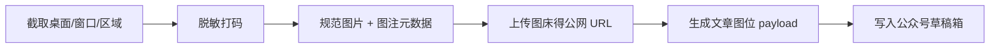

# 教程截图 → 公众号配图流程

写软件教程类公众号文章时，往往需要把产品界面截图放进正文。这套流程把「截屏 → 脱敏 → 上传 → 插入文章」串起来，复用本项目已有的公众号发布链路。

## 为什么需要单独一套流程

公众号正文只接受**公网可访问的 jpg/png/gif/webp**，本地路径和 base64 都进不去。而且软件界面里常有账号名、token、历史记录等隐私，直接截图发布等于二次泄露。所以不能只截个图就完事，要走完整链路。

## 整体链路



## 依赖

- Python 3.10+
- Pillow（`pip install pillow`），截屏与图像处理都靠它，无需 pyautogui / mss / pywin32
- 公众号上传需红草连接器（见主 README 的发布边界说明）

## 第一步 截图并脱敏

`scripts/tutorial_capture.py` 支持三种截图模式：

```bash
# 全屏
python scripts/tutorial_capture.py --mode full --out output/shots --redact

# 交互式框选区域（运行后用鼠标拖拽，Enter 确认）
python scripts/tutorial_capture.py --mode region --out output/shots --redact

# 按窗口标题截取（如截某个应用窗口）
python scripts/tutorial_capture.py --mode window --match "应用名" --out output/shots --redact

# 截图前延迟 3 秒，方便切换到目标界面
python scripts/tutorial_capture.py --mode full --delay 3 --out output/shots
```

### 脱敏的三种方式

软件截图里通常有账号名、邮箱、token、历史会话标题。本工具提供三种打码方式：

1. **交互框选（推荐）**：`--interactive-redact`，截图后弹出预览，用鼠标框住要打码的区域，Enter 完成。最直观，不依赖 OCR。
2. **手工坐标**：`--mask x0,y0,x1,y1[:标签]`，可重复。适合固定版式的批量截图。
3. **预设模板**：`--preset workbuddy-left-bottom`，内置常见侧栏隐私区域的比例遮罩。使用前务必在实际截图上核对位置。

```bash
# 交互框选打码 + 图注
python scripts/tutorial_capture.py --mode full --out output/shots \
    --interactive-redact --note "主界面概览"

# 预设模板 + 手工补充
python scripts/tutorial_capture.py --mode full --out output/shots \
    --preset workbuddy-left-bottom --mask "1500,20,1900,60:账号名"
```

> 注意：本工具**不含 OCR**，无法自动识别文字内容打码。`--keyword` 参数只把关键词写入元数据作为人工检查提醒，不会自动遮盖。发布前请肉眼确认每张图。

每次截图生成 `shot_001.png`、`shot_002.png` 递增编号，以及 `shots_meta.json` 记录尺寸、模式、图注、脱敏状态。

## 第二步 生成上传清单

```bash
python scripts/tutorial_publish.py --shots output/shots --prepare
```

生成 `output/shots/upload_list.json`，包含每张图的 base64 和空的 `url` 字段。

## 第三步 上传到图床

用红草连接器的 `get_upload_channel` 工具，把 `upload_list.json` 里每张图的 `base64` 传进去（scene 选 `body`，content_type 按实际格式），拿到公网 URL 后回填到对应条目的 `url` 字段。

正文图上限 1MB，超限会自动缩小成 jpg。上传通道在配合发布文章时已验证可用。

> 如果图片带 `Content-Disposition: attachment` 导致公众号判为格式非法，可用图片代理把响应头转成 inline。

## 第四步 生成文章图位 payload

```bash
python scripts/tutorial_publish.py --shots output/shots --build \
    --title "某某教程" --out output/tutorial_article.json
```

生成带 `image` + `paragraph`（图注）交替的 blocks，可直接交给红草 `create_article` 写入草稿箱。图注取自截图时的 `--note`。

## 写作建议

- 每张图配一句图注，说明这张图在演示什么，别只甩图。
- 截图顺序跟文章结构对应，一张图讲清一个动作。
- 关键操作区域可以用 `--mask` 之外的标注工具加箭头/框（本工具专注脱敏，标注可在图片编辑器里补）。
- 发布前逐张检查脱敏，尤其是左下角账号、顶部标题栏、历史会话列表。
